# 关卡与舞台设计 v0.2

> 对应网页灰盒 v0.2（`prototype/index.html`），回应第一轮试玩的 12 条反馈。
> 故事、台词、面具规则仍以 `docs/design.md` 为准；**空间、动线、几何体怎么动、灯光**以这份文档为准。
> 所有坐标和尺寸的准确数字在 `prototype/data/layout.json` 里（灰盒自动导出），文档里的数字是取整后的说明。

### 灰盒 v0.2 截图

| | |
|---|---|
| 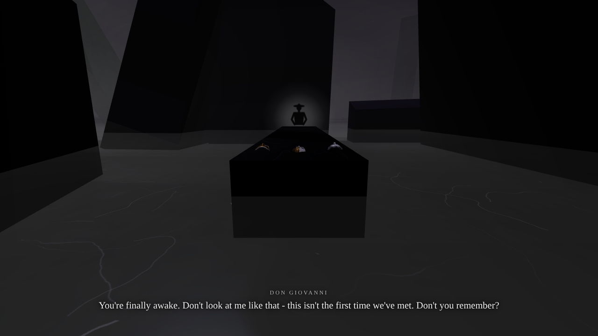 开场：桌前 | 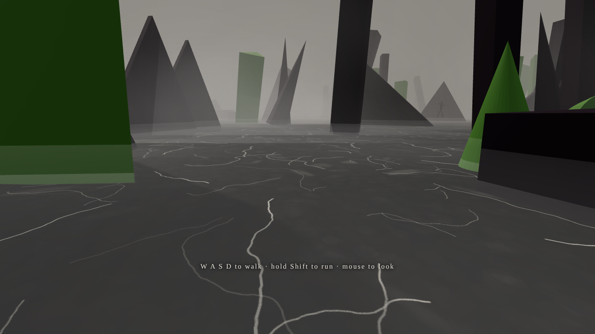 序曲走廊 |
| 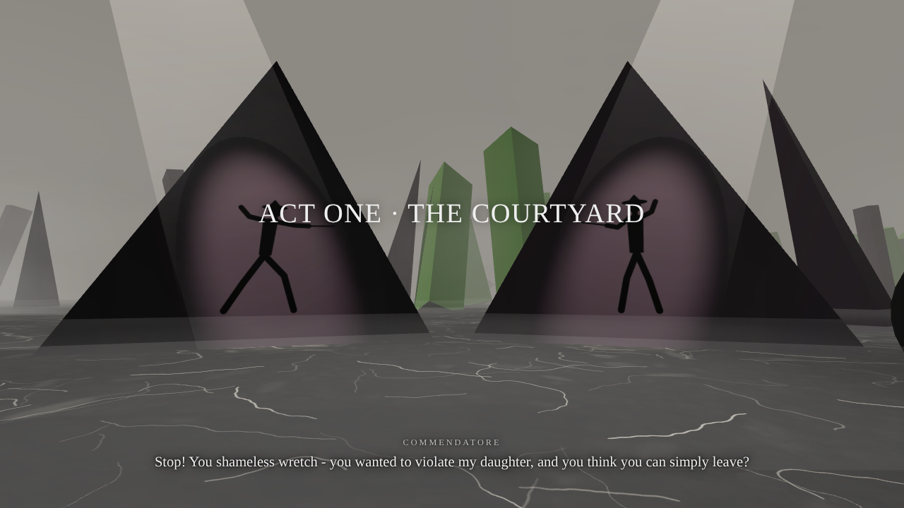 第一幕：收拢 | 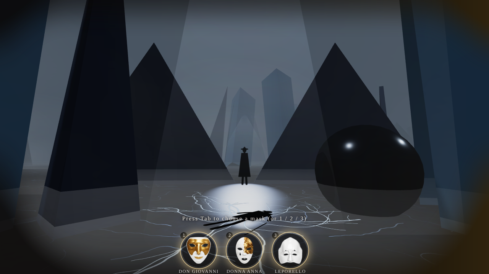 第一幕：安娜的面具 |
| 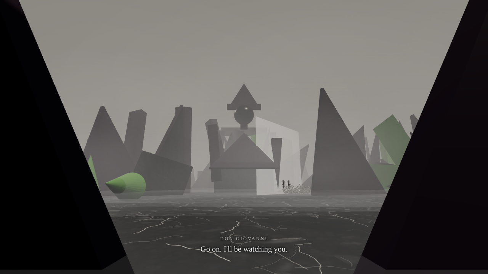 阳台：大黑影拼上 | 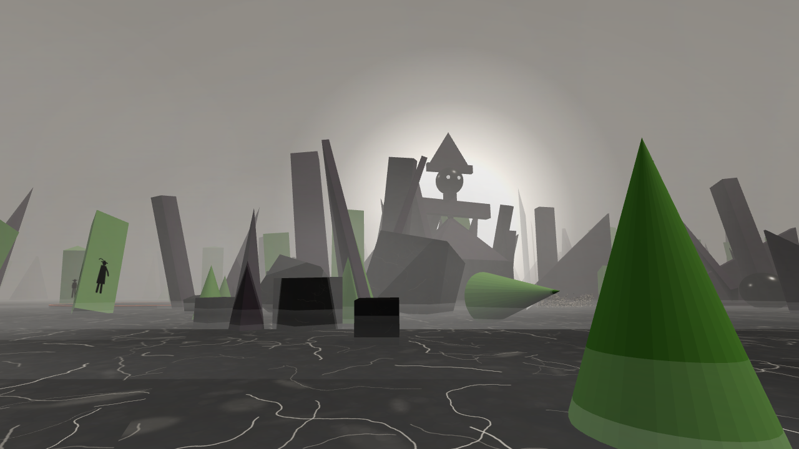 与巨像同行 |
| 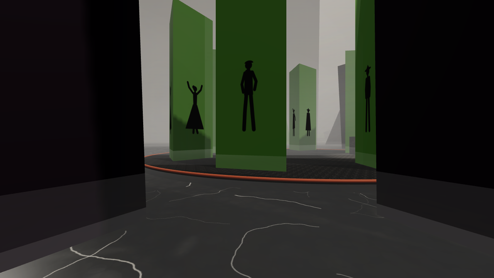 第二幕：旋转舞台 | 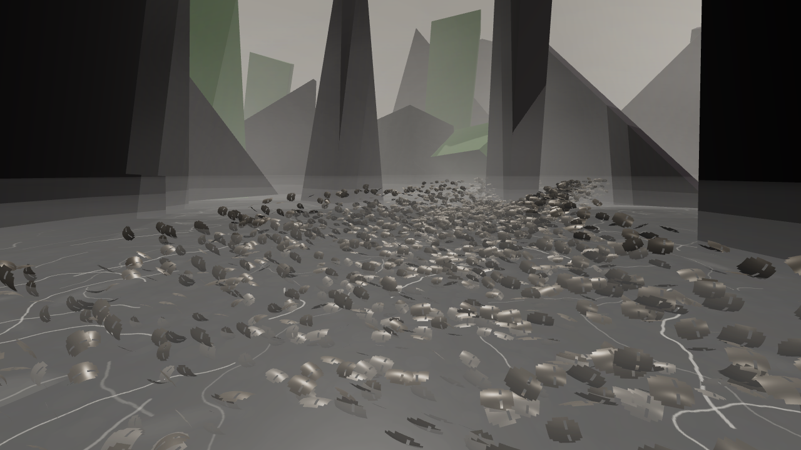 第三幕：面具堆 |

---

## 0. 这一版回应了哪些反馈

| # | 反馈 | 这一版怎么做 |
|---|---|---|
| 1 | 走得太慢，不能跑 | 走路 2.4 m/s（原来 1.4），按住 Shift 跑 4.6 m/s；走路有轻微的头部起伏 |
| 2 | 路线要是环形，绕着大黑影；不要靠地面宽窄限制路线；地面要是平地 | 整个世界是**一整块平地**。路线是绕着中心巨像的**顺时针螺旋**，巨像始终在玩家右手边。路只由几何体围出来：前面的几何体从雾里挪过来、让开，身后的几何体合拢 |
| 2 | 第一幕结束后大黑影没有变成完整的；眼睛不在大黑影身上 | 大黑影的零件在阳台上对准以后，会**真的飞到一起**组成一座完整的巨像，此后一直站在中心；眼睛是长在它头上的两颗白球，头会慢慢转过来看着玩家 |
| 3 | 几何体移动不要互相穿模；大黑影也要用舞台本身的几何体拼；先定基础几何体 | 先定了 10 种基础几何体（见第 2 节），**游戏里所有布景都只用它们**，包括大黑影和开场的桌子。几何体移动时会互相避让；每个场景状态都有自动检查，保证静止时没有任何两件重叠 |
| 4 | 要有雾，让人看不出场景多大 | 指数雾 + 贴地的三层薄雾 + 中景飘动的雾团；外圈约 140 件倾斜、倒塌的几何体藏在雾里，看不到边界 |
| 5 | 不要非得走进圆圈 | 去掉了发光的圆圈。进入一幕后，四周的几何体**慢慢向玩家合拢**，最后只剩剧情点前面那一块空地；同时有一束追光落在那里 |
| 6 | 戴面具要有手托着面具扣到脸上的第一人称动画 | 一只深色的手从屏幕下方托起面具，先看到面具正面，转过来扣到脸上（约 1 秒），扣上的瞬间画面暗一下、眼洞暗框出现；同一时间几何体快速重组成这张面具下的场景。摘下时手把面具拿开 |
| 7 | 刚进来就能看到唐璜身后有两人在打架 | 第一幕在螺旋上距离开场 60° 以外，中间隔着墙、雾和弯道，开场时看不到 |
| 8 | 大小、比例、颜色、排布要考究，要有压迫感和神秘感 | 几何体按 Jarman 模型的比例放大到 8–24 m 高，玩家只有 1.75 m；墙向路中间倾斜；颜色用模型原本的深紫、绿和黑白大理石；中心巨像在雾里被背光照成剪影，始终看着玩家 |
| 9 | 任何光下都要看得清环境；追光打在主要角色身上 | 每套配色都保证有足够的环境光，另加一盏冷色补光把深色几何体和背景分开；**每一幕的主要人物都有一束追光**（带可见的光柱） |
| 10 | 动线要像真正的地编和关卡设计师 | 见第 4 节动线表：压缩—释放、地标（中心巨像）、取景框（阳台的 V 形窗）、单向前进（身后合拢）、不走回头路 |
| 11 | 几何体不要从地里长出来 | 所有几何体只靠**平移、转身、倾斜**换位置，从附近（或雾里）挪过来；只有舞台升降台会升降（开场桌子沉下去、第一幕高台、第二幕审判席） |
| 12 | 第三幕几何体没有动；面具太散 | 第三幕的墙从雾里挤进来，越走路越窄（半宽从 2.8 m 收到 0.68 m），墙越来越高；地上 14,000 多张面具，多层堆叠，靠墙堆得更高 |
| — | 对话点一下就进下一句 | 点鼠标、按空格或回车，立刻显示下一句 |

---

## 1. 设计原则

1. **环境是主角。** 玩家在走，环境也一直在动：前方的墙从雾里挪过来围出路，身后的墙合拢，进入场景时四周向玩家收拢，戴面具时整个场景重组，远处的几何体在雾里缓慢漂移。尽量不出现"玩家在动、世界静止"的时刻。
2. **只用 Jarman 的几何体。** 布景只有第 2 节那 10 种形体，各有固定比例和几档尺寸；人物只用平面剪影。
3. **挪过来，不长出来。** 几何体不缩放，也不从地里冒出来；只有舞台升降台可以上下。
4. **不穿模。** 每个场景状态都自动检查重叠；移动时几何体互相避让，也会在玩家面前停住，绝不撞到玩家。
5. **用空间引导，不用界面。** 没有发光圆圈、没有箭头。引导靠合拢的几何体、开出来的路、追光和地标。
6. **永远看得清。** 再暗的配色也保留足够的环境光，深色几何体靠补光和雾色衬出轮廓；人物一定有追光。
7. **雾藏住边界。** 不让玩家看到世界的尽头。
8. **疏密有致。** 走廊有前后两层墙，路口外、来路和去路都有东西；外圈雾里散落着倾斜、倒塌、互相倚靠的几何体。

---

## 2. 基础几何体（来自 Jarman 的舞台模型）

所有网格的轴心都在底面中心。尺寸 = 比例 × 档位（单位 m）。

| 名字 | 形体 | 模型里的样子 | 比例（宽 : 高 : 厚） | 档位（宽） | 颜色 |
|---|---|---|---|---|---|
| Prism | 正三棱柱 | 后排的绿色高棱柱 | 1 : 3 : 1 | 2.4 / 3.2 / 4.2 / 5.2 | 绿 |
| Spike | 四棱锥尖碑 | 细高的紫色尖碑，常立在大理石方块上 | 1 : 5 : 1 | 1.2 / 1.8 / 2.6 / 3.4 | 深紫 |
| Sail | 等腰三角形薄板 | 左前方的大三角板 | 1 : 0.85 : 0.035 | 7 / 11 / 16 / 20 | 深紫 |
| Blade | 直角三角形薄板（竖边在一侧） | 右侧的斜板 | 1 : 1 : 0.04 | 5 / 8 / 12 / 15 | 深紫 |
| Pillar | 长方柱 | 中间的深紫立柱 | 1 : 6 : 0.6 | 1.2 / 1.6 / 2.2 / 2.8 | 深紫 |
| Notch | 斜顶板（一侧高、一侧低） | 中间偏右那块斜顶的板 | 1 : 1.7 : 0.14 | 3 / 4.5 / 6 | 深紫 |
| Cube | 立方体 | 大理石底座、台阶 | 1 : 1 : 1 | 0.55 / 1.5 / 2.5 / 4 / 6 | 黑白大理石 |
| Orb | 球 | 左边的黑球 | 1 : 1 : 1 | 0.6 / 1.4 / 2.6 / 4.2 | 黑（眼睛用白） |
| Drum | 圆柱 | 躺着的白色圆柱 | 1 : 0.9 : 1 | 1.6 / 2.4 | 白 |
| Cone | 圆锥 | 右前方的绿色小圆锥 | 1 : 1.7 : 1 | 1.4 / 2.2 / 3.2 | 绿 |

地面是黑底白纹的大理石；第二幕的旋转舞台边缘用模型底座的橙色线。

---

## 3. 世界布局

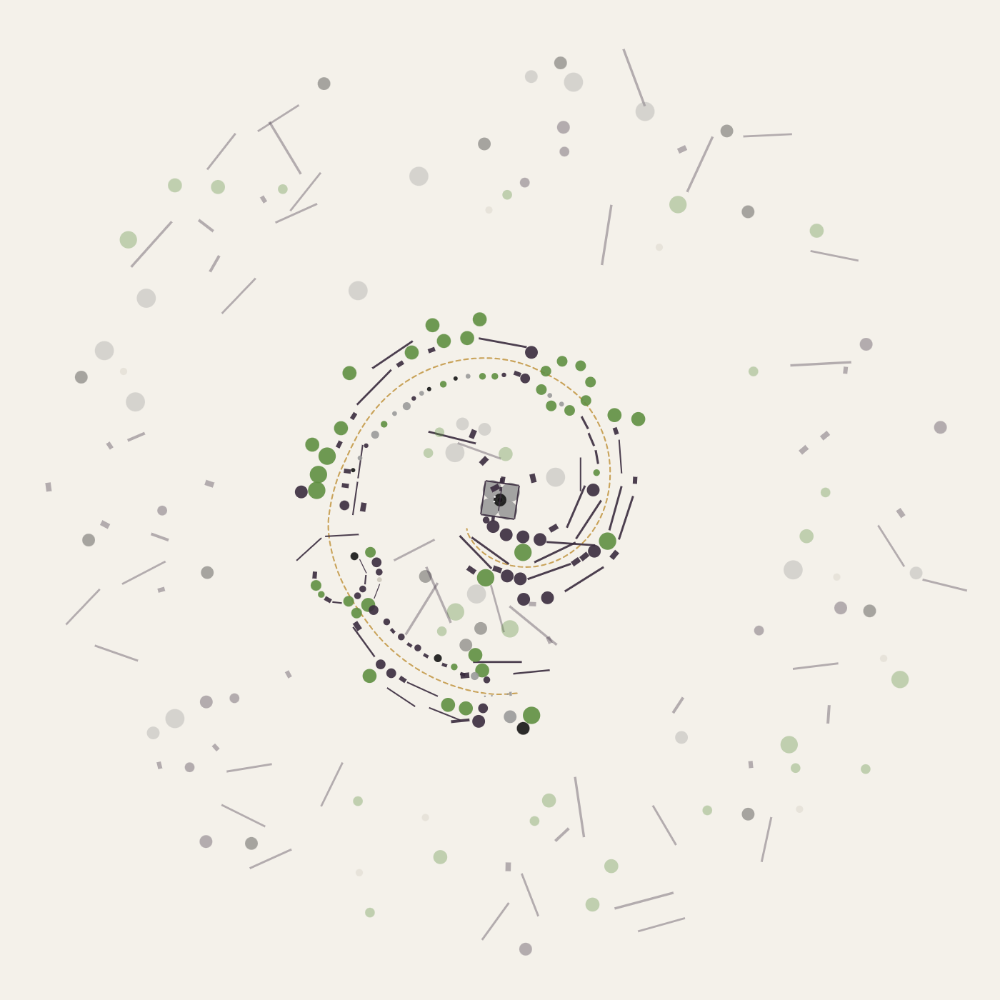

游戏开始时的样子（墙都还在雾里等着，巨像还是一团悬浮的零件）：

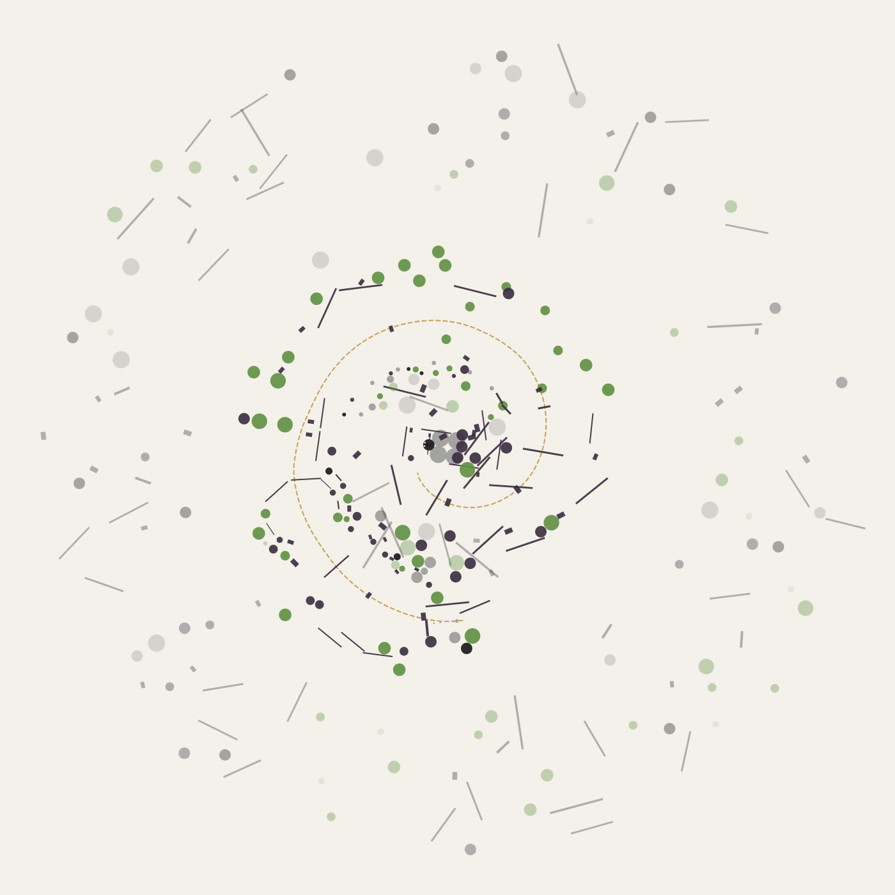

- 一整块直径 460 m 的大理石平地，雾把边界藏住。
- 中心是骑士长的巨像：12 × 12 × 6 m 的大理石台座，上面的身体由紫色几何体拼成，戴帽子，总高约 26 m。
- 路线是**绕巨像的顺时针螺旋**，从外圈（半径 64 m）开始，一圈多以后收到巨像脚下（半径约 14 m）。巨像始终在玩家右手边，走到哪里都能从墙缝里看到它。路线总长约 **310 m**。
- 外圈（半径 80–150 m）和两圈之间散落着约 140 件倾斜、倒塌、互相倚靠的几何体，都在缓慢漂移；它们避开每一幕的场地。

路线上的段落（φ 是从正南起顺时针的角度）：

| 段落 | φ | 半径 | 路半宽 | 风格 |
|---|---|---|---|---|
| 开场：桌前 | 0° | 64 m | 3.2 m | 黑暗，残骸 |
| 序曲走廊 | 4–46° | 64 → 60 m | 3.2–4.6 m | 两层墙，宽松 |
| 收窄 | 46–54° | 60 → 59 m | 2.4 m | 高墙，压迫 |
| **第一幕：庭院** | 54–80°（标记点 64°） | 约 58 m | 场景 | 庭院 |
| 收窄 | 80–100° | 57 → 54 m | 2.2–3.0 m | 高墙 |
| **阳台（大黑影）** | 98° | 54 → 49.6 m（往中心伸出的小平台） | 1.45 m | V 形窗 |
| 与巨像同行 | 100–186° | 52 → 46 m | 3.2–5.0 m | 内侧墙矮，能看到巨像 |
| 收窄 | 186–200° | 46 → 44 m | 2.6 m | 高墙 |
| **第二幕：旋转舞台** | 200–220°（中心 210°） | 约 43.5 m | 场景 | 舞台 |
| 走出舞台 | 220–262° | 42 → 36.5 m | 3.2–3.6 m | 两层墙 |
| **第三幕：审判地** | 262–410° | 36.5 → 13.6 m | 2.8 → 0.68 m | 越来越窄、越来越高 |

---

## 4. 动线

| 段 | 玩家在做什么 | 环境在做什么 | 光 | 时长 |
|---|---|---|---|---|
| 开场 | 在黑暗里醒来，只能转头；听唐璜说话 | 四周是倾向桌子的残骸；面具在桌上像液体一样流动 | 一束暖光照桌面，一束冷光勾出唐璜的轮廓 | 约 1.5 分 |
| 天亮 | 开始走 | 桌子从地板的活门沉下去，残骸一件件立起来变成第一段墙，前方的墙从雾里挪过来，路出现了 | 雾从黑色慢慢变成灰白 | — |
| 序曲走廊 | 沿路走（可以跑） | 前面的墙从雾里挪过来、让开，身后的墙合拢；右边墙缝里偶尔看到中心悬浮的碎片 | 中性 | 约 30 秒 |
| 收窄 | 穿过一段又窄又高的墙 | 墙向路中间倾斜 | — | 约 5 秒 |
| **第一幕** | 走进庭院；四周的几何体向你收拢，把你推到决斗前面；戴三张面具 | 见 6.3 | 两束追光打在决斗的剪影上；一束追光落在你该站的地方 | 约 4 分 |
| 收窄 → 阳台 | 前路被几何体挡住，只有右边一个小平台开着 | 小平台尽头两块三角板形成 V 形窗，正对中心 | — | — |
| **阳台** | 站到窗前往中心看：悬浮的碎片拼成戴帽子的人影 | 拼上的一瞬间眼睛亮起；唐璜说话；碎片飞到一起变成完整的巨像；前路打开 | 巨像身后亮起背光 | 约 1 分 |
| 与巨像同行 | 绕着巨像走 | 巨像的头慢慢转过来跟着你；内侧墙矮，能一直看到它 | — | 约 40 秒 |
| **第二幕** | 踏上旋转舞台，被舞台带到中心 | 见 6.6 | 追光打在你身上，之后打在台座上的两个影子上 | 约 5 分 |
| 走出舞台 | 唐璜说"这有什么的……" | 身后合拢 | — | 约 20 秒 |
| **第三幕** | 面具从手里掉落；越走越窄，越走越慢 | 墙从雾里挤进来，越来越高；脚下的面具越来越厚；巨像俯下身来 | 雾越来越浓、越来越亮 | 约 1.5 分 |
| 结局 | 停在玻璃前；回答 | 雾散开，是俯身的骑士长；玻璃碎裂，墙倒下，火 | 背光 → 地狱的红色 | 约 1.5 分 |

动线上用到的几种手法：
- **压缩—释放**：每一幕前都有一段又窄又高的路（收窄），走出来豁然开朗。
- **地标**：中心巨像，走到哪里都能看到，第一次是碎片，之后是完整的人形。
- **取景框**：阳台的 V 形窗只框住中心，玩家自然会往那里看。
- **单向前进**：身后的墙合拢，前方的路随着你走过去才打开，不会走回头路，也不会提前看到后面的场景。
- **被推着走**：每一幕里四周向你收拢，自然把你推到剧情点，而不是靠提示。

---

## 5. 几何体怎么动（舞台机械规则）

每件几何体都有几个命名的**站位**，游戏只会让它在站位之间移动。

- **速度**：大件慢、小件快，`clamp(3.3 − 0.07 × 高度, 1.5, 3.2)` m/s；起步和停下有缓动；转身每秒 32°。戴面具时场景重组的速度乘 2.1，摘下时乘 1.7。
- **互相避让**：移动中的几何体看自己 0.45 秒后的位置，如果会和别的几何体靠得比 0.7 m 还近，就往旁边绕（带一点侧向偏移，避免两件迎面卡住）。
- **让玩家**：任何移动的几何体离玩家不到 1.1 m 时，就不再往玩家的方向前进。所以几何体可以把玩家"挤"过去，但不会撞到或压住玩家。
- **远处**：离玩家 95 m 以外的几何体不做避让，直接滑过去（在雾里看不到）。
- **静态检查**：每个场景的每种状态都检查一遍，任何两件几何体的占地都不能重叠，倾斜的几何体顶部也不能互相碰到，玩家站的空地里也不能有东西。当前结果：**0 处问题**（调试面板里有"check overlaps"按钮）。

**走廊**：每件走廊几何体有三个站位，按玩家已经走到的最远位置自动切换：
- **前方**：玩家还没走近时，大多数在路外 7–15 m 的雾里斜着、歪着等着，少数横在路中间当"门"；
- **墙**：玩家走到它前面 17–27 m 时，挪到路边站好（向路中间倾斜一点）；
- **身后**：玩家走过 5–10 m 以后，一半向路中间合拢、封住来路，另一半向外倒退进雾里。

每件的切换距离都略有不同，所以墙是一件一件、陆陆续续动起来的。走廊有两层：第一层贴着路，第二层在后面 4–7 m，更高，补出纵深。

---

## 6. 各场景

### 6.1 开场：桌前
- 桌子由基础几何体拼成：一根躺倒的大理石方柱当桌面，两块小方块当桌腿，唐璜坐在第三块小方块上。
- 四周 9 件残骸都倾向桌子，像一个倒塌的舞台模型压在头顶。
- 台词结束后：桌子从活门**沉下去**（升降台），唐璜的剪影淡去，面具飞进面具栏；残骸一件件立起来，变成序曲走廊的第一段墙。

### 6.2 序曲走廊
两层墙，宽松，节奏是"走—看"：右边内侧的墙矮一些，让玩家偶尔透过缝隙看到中心悬浮的碎片，埋下大黑影的伏笔。

### 6.3 第一幕：庭院

| 状态 | 平面 |
|---|---|
| 进门前：开阔的庭院，几何体散在四周，决斗在尽头 | 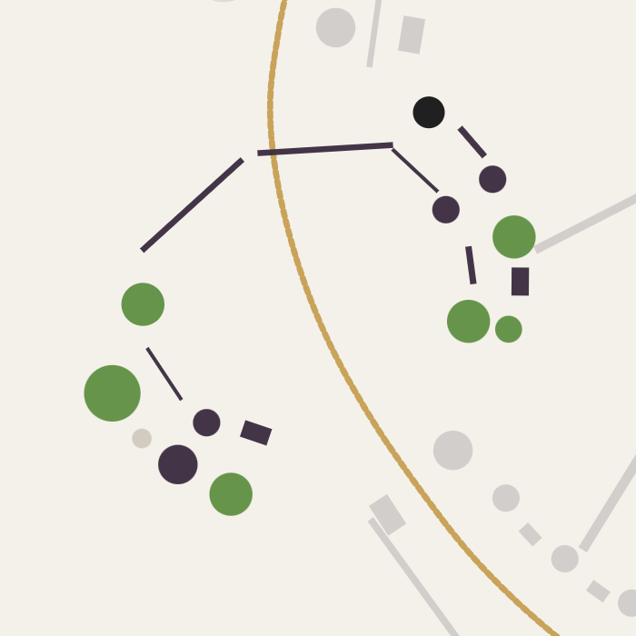 |
| 收拢：几何体合拢成一圈，只朝决斗那边开口 | 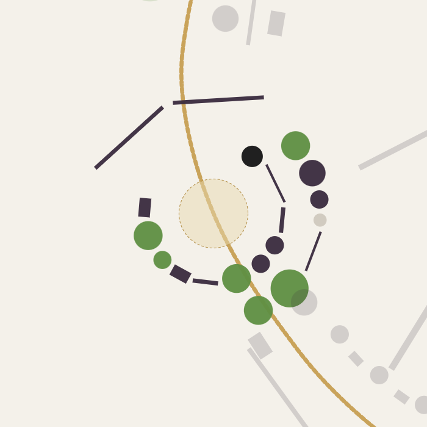 |
| 唐璜：两排整齐的对决道路，两块板在尽头并排 | 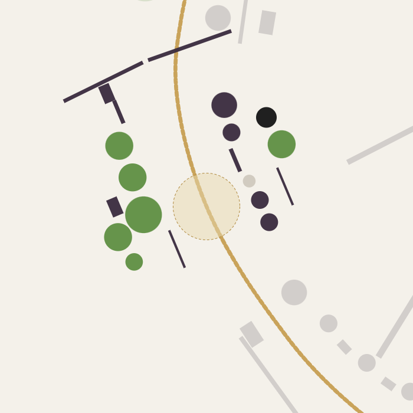 |
| 安娜：向里倾斜的牢笼，只在决斗方向留一道窄缝，唐璜站在两块板之间的 V 形缝里 | 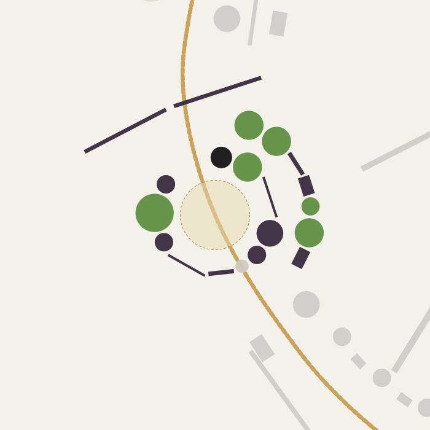 |
| 仆从：贴着玩家的一圈坑壁，只有一条细缝；决斗被两个升降台托到 3.5 m 高 | 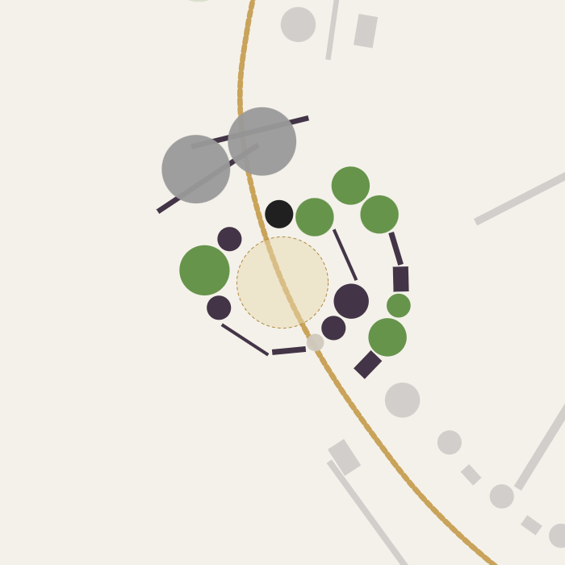 |
| 出口：正前方的几何体让开，两块板退到两边 | 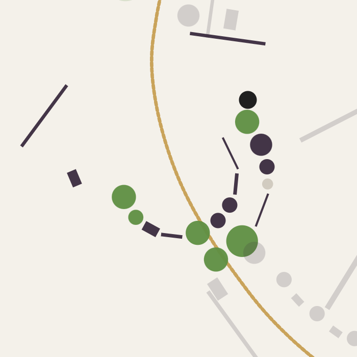 |

流程：
1. 走进庭院南沿：出现"ACT ONE · THE COURTYARD"，身后的墙合拢。
2. 四周的几何体以 1.35 m/s 向标记点收拢（约 18 秒），可走的范围随之缩小，但永远不会缩到玩家脚下。同时播 A1-0 的四句台词。一束追光落在标记点上。
3. 玩家走到标记点 4.2 m 以内：面具可以戴了。
4. 戴面具：手把面具扣上；几何体以 2.1 倍速度重组；配色过渡 1.6 秒；内心独白。
5. 三张都看过、摘下以后：出口打开（乌鸦从决斗板后面飞散）。

### 6.4 阳台：大黑影
- 收窄的路尽头被几何体挡住，只有右边（朝中心的一侧）开着一个 4.4 m 长的小平台。
- 平台尽头两块 Sail 并排，中间留 1.2 m 的缝，两块三角形的斜边张开成一个 **V 形窗**，正好框住中心。
- 巨像的 14 件零件悬在中心的雾里，每件都沿着"从阳台看过去的视线"前后错开（0.72–1.3 倍距离）。所以只有站在窗前（1.4 m、12° 以内）它们才拼成戴帽子的人影，从别的角度看是一团散开的几何体。
- 拼上：两颗眼睛亮起，唐璜说"你都看见了……我会一直看着你"；然后零件在约 7 秒里飞到一起，组成完整的巨像；巨像身后亮起背光，前路打开。

### 6.5 与巨像同行
内侧墙用矮的几何体（方块、圆锥、球、矮尖碑），外侧墙高。巨像的头（头、眼睛、帽子一组）以每秒 14° 的速度转向玩家，最多转 80°。

### 6.6 第二幕：旋转舞台

| 状态 | 平面 |
|---|---|
| 进门前：8 根绿棱柱斜着等在雾里 | 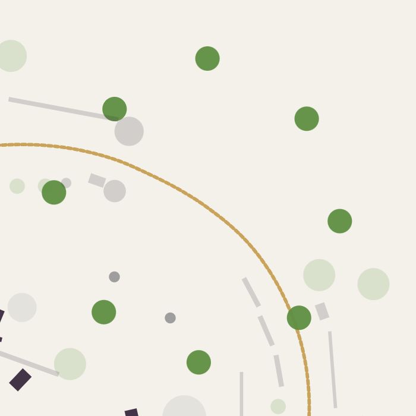 |
| 中间：一圈棱柱，两个台座在朝巨像的一侧 | 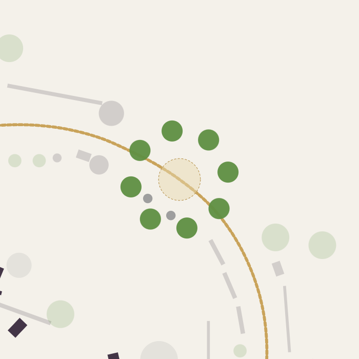 |
| 唐璜：棱柱排成通往雾里的逃跑之路 | 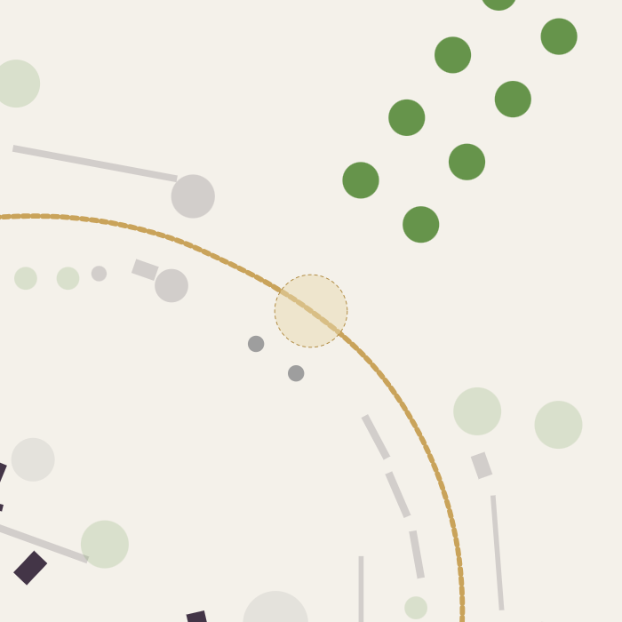 |
| 安娜：台座被升降台顶到 8 m 高，后面一排方柱和两块大帆板组成审判庭 | 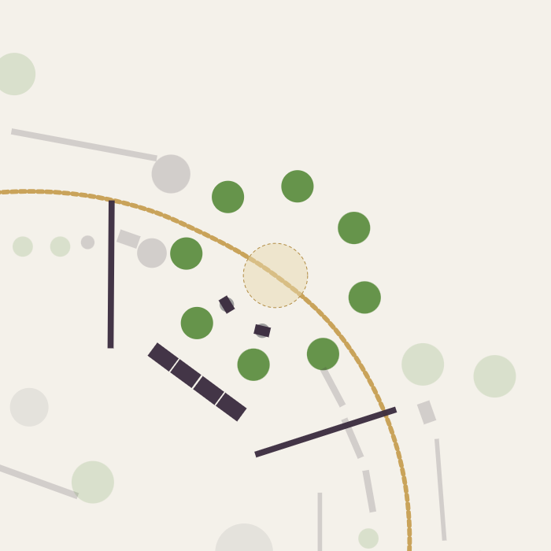 |
| 仆从：棱柱贴着玩家围成一圈并向里倾斜，台座被推到眼前，巨手从上方压下 | 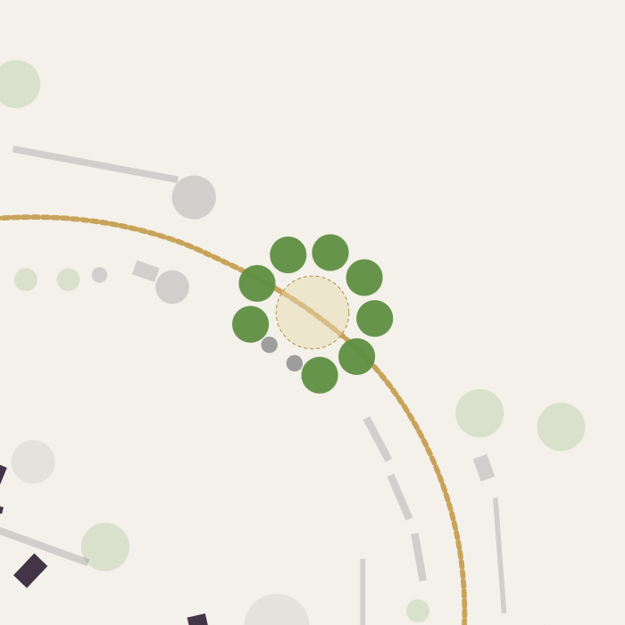 |

流程：踏上舞台 → 舞台转 110°，把玩家带进来；棱柱从雾里挪进来合成一圈 → 玩家被送到中心 → 棱柱绕玩家公转一圈、各自转三圈，玩家脚下的影子转圈、分成两个 → 换装 → 两个台座从巨像那一侧滑进来，影子站上去 → 面具 → 指认 → 出口方向的棱柱让开。

两个台座放在朝巨像的一侧，所以玩家看着两个影子时，背景就是雾里看着这一切的巨像。

### 6.7 第三幕：审判地
- 墙全部用最大档的方柱、棱柱、尖碑和斜板，从雾里挤进来；路的半宽从 2.8 m 收到 0.68 m，墙向路中间倾斜，但顶部不会碰到一起。
- 地上 14,000 多张铁面具，越往里越厚，靠墙的地方堆到 1 m 多高；玩家踩在上面会稍微升高，脚步是铁片相撞带回声的声音。
- 进入第三幕：三张面具从面具栏掉到地上。
- 离终点 32 m 时，巨像开始俯身：头、帽子、肩膀从台座上探出来，脑袋低垂在玻璃后面，两根方柱撑在玻璃后的地上，像两只按在玻璃上的手。
- 离终点 12 m 以内，走路越来越慢（最慢是原速的 0.42）。

### 6.8 结局
停在玻璃前 → 问话 → 选项（15 秒不选算沉默）→ 雾散开，镜头抬起来看到低垂的头和发光的眼睛 → 骑士长说话 → 玻璃裂开 → 两边的墙倒下，画面转为地狱的红色 → 低头看到自己的双臂被绑在一根横梁上（第一人称 3D）→ 唐璜的喊叫 → 火从下面升起 → 黑屏 → 结尾句。

---

## 7. 灯光与雾

- **配色**：void（开场）、neutral（原样 = 唐璜）、anna（冷蓝灰）、servant（暗红）、judgement（第三幕，越来越亮的白雾）、inferno（结局）。每套都给了足够的半球光（1.0–1.35），深色几何体在雾里始终有轮廓。
- **补光**：一盏不投影的冷色平行光，从主光的反方向打过来，颜色跟着配色变化。
- **追光**：6 盏一组的追光池（数量固定，不会造成着色器重新编译），每束都有可见的光柱。规则：**每一幕的主要人物一定有追光**——决斗的两个剪影、站在门缝里的唐璜、地上的骑士长、台座上的两个影子、转台中心的玩家。
- **巨像的背光**：一团大的柔光，始终放在巨像相对玩家的背面，所以从任何角度看，巨像都是被光勾出来的黑色剪影。
- **雾**：指数雾（neutral 下大约 60 m 开始看不清），加三层贴地薄雾（图案固定在世界里、缓慢飘动），加 26 团中景雾团，围着玩家缓慢转动。

---

## 8. 第一人称面具动画（约 1 秒）

| 时间 | 发生什么 |
|---|---|
| 0–0.5 秒 | 手托着面具从屏幕右下方抬起，先看到面具正面，再转过来 |
| 0.42 秒 | 场景开始重组（不等手放下） |
| 0.5–0.8 秒 | 手把面具压到脸上，面具内壁填满画面 |
| 0.8 秒 | 画面暗一下，眼洞暗框出现 |
| 0.8–1.15 秒 | 手放下离开画面 |

摘下：手抬起来抓住面具（0.28 秒），暗框消失，手把面具拿开（0.45 秒）。换面具时先摘再戴。

---

## 9. 下一步

- 在真显卡上看帧率；第三幕的面具数量、雾团数量可以按帧率调整。
- 台词里标了"草稿"的部分请负责剧情文本的同学改定。
- 美术可以从 `prototype/assets/silhouettes/` 的剪影和 `data/kit/` 的几何体开始替换成正式资源。
- 音乐和音效目前都是合成的占位声音。
