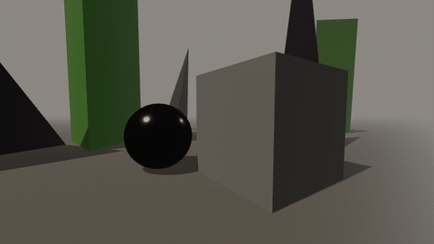
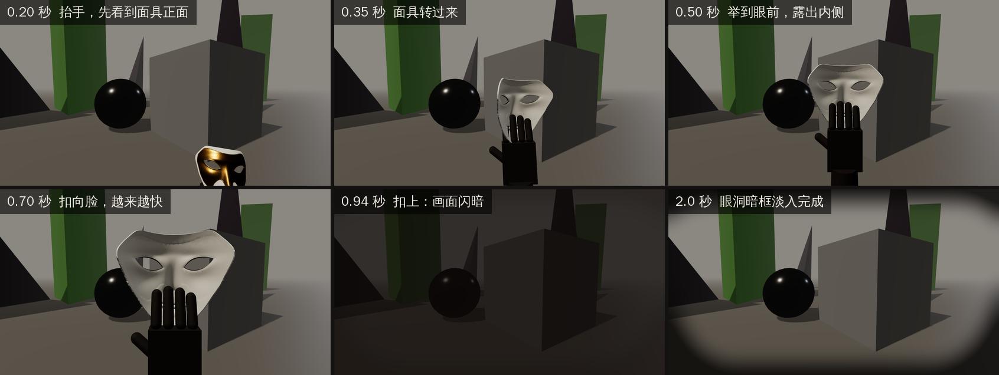
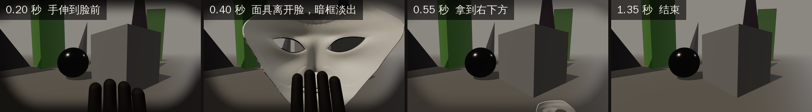
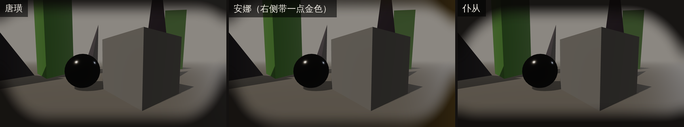

# 戴面具 / 摘面具：手部动画和眼洞暗框（单独提取）

从网页灰盒 v0.2 里单独拿出来的戴面具和摘面具效果：
- 一只手托着面具抬到眼前，转过来，扣到脸上；
- 扣上的瞬间画面闪暗一下，然后屏幕边缘淡入这张面具的眼洞暗框；
- 摘下时反过来。

这个包只有这一个功能，不依赖灰盒的其他部分，可以先单独做进现有的 UE 工程。



## 先在浏览器里看

双击 `demo.html`，用 Chrome 或 Edge 打开（需要联网，three.js 从 jsDelivr 加载）。

| 操作 | 键位 |
|---|---|
| 戴唐璜 / 安娜 / 仆从的面具 | 1 / 2 / 3（或左上角的按钮） |
| 摘下 | R 或鼠标右键 |
| 慢放 | 空格切换 0.25×，左上角还有 0.5× 和 0.1× |
| 转头 | 点一下画面，然后动鼠标（Esc 退出） |

左上角会实时显示当前在哪一段、过了多少秒，以及暗框和闪暗的透明度，方便和 UE 里的效果逐帧对比。

## 包里有什么

| 文件 | 是什么 |
|---|---|
| `demo.html`、`demo_assets.js` | 独立演示页，以及它用的面具和暗框 |
| `mask_fx.json` | 全部数值，用 UE 的单位和坐标写 |
| `ue/Content/SM_DG_Hand.glb` | 第一人称的手（深色，右手），真实尺寸 |
| `ue/Content/SM_DG_Mask_Don.glb` / `_Anna` / `_Leporello` | 三张面具，真实尺寸。轴心在包围盒中心，已经转成戴上时的朝向 |
| `ue/Content/T_DG_Vignette_*.png` | 三张眼洞暗框，1600×900，带透明通道 |
| `ue/Content/SFX_DG_MaskMotif_*.wav` | 戴面具时的小动机，占位音效，可以不用 |
| `ue/Content/DG_AxisMarker.glb` | 核对坐标轴用 |
| `ue/Source/DGMaskFXComponent.h` / `.cpp` | UE 的 C++ 组件：手的动画、闪暗、暗框都在里面 |
| `tools/build_package.py` | 重新生成面具、暗框和 `demo_assets.js` |
| `img/` | 这份说明里的图 |

---

## 1. 效果拆解



**戴上，共 1.15 秒：**

| 段 | 时长 | 缓动 | 手 | 面具 |
|---|---|---|---|---|
| 抬手 `put_rise` | 0.50 秒 | 三次缓入缓出 | 从屏幕右下方外面抬到胸前，手从斜着慢慢转正 | 先让玩家看到正面；进度过 35% 后开始转身，最后内侧朝向玩家 |
| 扣上 `put_press` | 0.30 秒 | 二次缓入（越来越快） | 从胸前扣到脸上 | 内侧朝向玩家 |
| **扣上的瞬间** | | | | 面具从手里消失（已经戴在脸上）；画面闪暗；眼洞暗框开始淡入 |
| 放手 `put_drop` | 0.35 秒 | 三次缓入缓出 | 落回右下方，出画 | 不显示 |



**摘下，共 0.73 秒：**

| 段 | 时长 | 缓动 | 手 | 面具 |
|---|---|---|---|---|
| 伸手 `take_reach` | 0.28 秒 | 三次缓入缓出 | 空手从右下方伸到脸前 | 不显示 |
| **面具离开脸** | | | | 面具出现在手里；暗框开始淡出 |
| 拿开 `take_pull` | 0.45 秒 | 三次缓入缓出 | 把面具拿到右下方，出画 | 内侧朝向玩家 |

**其他规则：**
- **换面具**（戴着一张时按另一张）：先摘下旧的，再戴新的，共 1.88 秒。
- **动画进行中不接受新操作**；戴着某张面具时再按同一张，没有反应。
- **声音**：按下戴面具的那一刻播放一段四个音的小动机，每张面具不同。这是占位音效。

### 眼洞暗框



- 每张面具一张全屏图（1600×900，带透明通道），拉伸铺满屏幕。只压暗屏幕边缘，形状来自这张面具眼洞的外轮廓。
- 安娜那张右侧带一点金色，因为她右眼那一侧是金色的褶皱。
- 淡入、淡出都是 0.9 秒，曲线是 CSS 的 `ease`。如果中途反向，时长按剩下的距离缩短（比如淡入到一半就开始淡出，只要 0.45 秒）。

### 闪暗

颜色是 `#0d0907`（接近黑的深棕），在扣上的瞬间开始：0.14 秒内升到约 0.71 的不透明度，再用 0.23 秒退回 0，一共约 0.37 秒。

---

## 2. 数值（UE 相机坐标）

坐标是相机自己的坐标：**X 向前，Y 向右，Z 向上，单位厘米**。旋转用 `FRotator`（Pitch, Yaw, Roll），单位度。手的轴心在掌心中央，面具的轴心在它包围盒的中心。完整数值见 `mask_fx.json`。

**手掌的关键位置：**

| 名字 | 位置（厘米） | 在哪里 |
|---|---|---|
| `start` | (42, 22, −44) | 屏幕右下方外面，戴上从这里开始 |
| `show` | (33, 2.5, −13) | 胸前，面具在这里展示、转身 |
| `face` | (8.5, 0, −10) | 面具扣在脸上时 |
| `rest` | (30, 20, −55) | 屏幕右下方外面，戴上到这里结束，摘下从这里开始 |
| `take_end` | (45, 26, −50) | 屏幕右下方外面，摘下到这里结束 |

**每一段：** 位置在两个关键位置之间按缓动插值；手的 Pitch 和 Roll 一起插值，Yaw 始终是 0。

| 段 | 从 → 到 | 手的 Pitch | 手的 Roll |
|---|---|---|---|
| `put_rise` | start → show | −40.11 → 0 | −20.05 → 0 |
| `put_press` | show → face | 0 | 0 |
| `put_drop` | face → rest | 0 → 28.65 | 0 → 17.19 |
| `take_reach` | rest → face | 28.65 → 0 | 17.19 → 0 |
| `take_pull` | face → take_end | 0 → −34.38 | 0 → −17.19 |

缓动公式：三次缓入缓出 `k < 0.5 ? 4k³ : 1 − (−2k + 2)³ / 2`；二次缓入 `k²`；CSS `ease` 是 `cubic-bezier(0.25, 0.1, 0.25, 1.0)`。

**面具：**
- 位置 = 手掌位置 + (1.2, 0, 11.5)。这个偏移不跟着手转。
- 转身进度 `turn`：只在 `put_rise` 里变化，等于 `clamp((k − 0.35) / 0.65, 0, 1)`，其中 k 是缓动后的进度；其他段都是 1。`turn = 0` 时正面朝玩家，`turn = 1` 时内侧朝玩家。
- 旋转分三次、依次绕相机的轴转：先 Roll（手的 60%），再 Yaw = −180 × (1 − turn)，最后 Pitch（手的 60%）。在 UE 里写成 `FQuat(FRotator(Pitch, 0, 0)) * FQuat(FRotator(0, Yaw, 0)) * FQuat(FRotator(0, 0, Roll))`。
- **不能合成一个 `FRotator(Pitch, Yaw, Roll)`**：那样面具露正面的时候会往反方向倾斜，最多差 48°。

**场景提示：** 抬手开始后 0.42 秒（手还在往上抬）。灰盒在这一刻让几何体开始重组。

---

## 3. 做进 UE（5.8）

### 3.1 导入资源

1. 在内容浏览器里建文件夹 `/Game/DG/MaskFX/`（叫别的也行，只是之后要在组件上手动指定资源），把 `ue/Content/` 里的文件全部拖进去。
2. `.glb` 用默认的 glTF 导入（Interchange）。不要缩放，不要重新计算法线。导入后静态网格体应该叫 `SM_DG_Hand`、`SM_DG_Mask_Don` 等，和文件名一样。
3. 三张暗框贴图，打开后改：
   - Compression Settings 改成 `UserInterface2D (RGBA)`；
   - Texture Group 改成 `UI`；
   - Mip Gen Settings 改成 `NoMipmaps`；
   - 勾选 Never Stream。
4. 音效可选。`.wav` 直接导入。

### 3.2 坐标轴核对（1 分钟，必须做）

所有朝向都假设 UE 导入 glTF 时把 glTF 的 (x, y, z) 变成 UE 的 (x, z, y)。先验证这一点：把 `DG_AxisMarker` 拖进关卡，放在原点，不旋转、不缩放。

| 臂 | 应该指向 | 末端位置（厘米） |
|---|---|---|
| `arm_x`（1.0 m） | UE +X | (100, 0, 0) |
| `arm_y`（0.6 m） | UE +Z（向上） | (0, 0, 60) |
| `arm_z`（0.3 m） | UE +Y | (0, 30, 0) |

再在静态网格体编辑器里看一眼：
- `SM_DG_Hand`：手指朝上（+Z），拇指在左边（−Y），手背朝 −X；
- 三张面具：脸朝 +X。

对不上的话，在组件的 `HandMeshRotation` 和 `MaskMeshRotation` 里补一个旋转，让它们变成上面的朝向。

### 3.3 加 C++ 组件

> **注意：** 这两个 C++ 文件是在没有 UE 的云端环境里写的，**还没编译过**。报错的话多半是小问题，比如头文件路径；可以交给本地的 Claude Code 窗口修。逻辑和 `demo.html` 一一对应，已经和灰盒的原始公式逐帧核对过。

1. 先确定工程能不能编译 C++：
   - **已经是 C++ 工程**：把 `ue/Source/DGMaskFXComponent.h` 和 `.cpp` 复制到 `Source/<工程名>/` 下。如果工程分了 `Public/` 和 `Private/`，`.h` 放 `Public/`，`.cpp` 放 `Private/`。
   - **纯蓝图工程**：在编辑器里点 Tools → New C++ Class → Actor Component，名字填 `DGMaskFXComponent`。创建完关掉编辑器，用包里的两个文件覆盖生成的同名文件。这一步需要装 Visual Studio 2022，并勾选"使用 C++ 的游戏开发"。
2. 打开 `Source/<工程名>/<工程名>.Build.cs`，加上 Slate 依赖。模板里通常有一行被注释掉的 `PrivateDependencyModuleNames.AddRange(new string[] { "Slate", "SlateCore" });`，把注释去掉就行。
3. 编译，重新打开编辑器。

### 3.4 挂到角色上

1. 打开第一人称角色的蓝图 → Add Component → `DG Mask FX`。
2. 组件会自动找角色身上的第一个相机。如果角色有好几个相机，在 BeginPlay 里调用 `SetCamera`。
3. 资源：
   - 如果资源放在 `/Game/DG/MaskFX/`，空着的手、面具、暗框槽位会在开始游戏时自动填上；放在别处就手动拖进去。
   - 音效槽不会自动填，想要的话手动指定 `SFX_DG_MaskMotif_*`。
   - **要打包游戏的话**，请手动指定所有槽位。自动填只按路径加载，打包时这些资源可能不会被打进去；或者把这个文件夹加进 Project Settings → Packaging → Additional Asset Directories to Cook。
4. 绑按键（Enhanced Input 或旧的 Input Action 都行）：1 → `WearMask(0)`，2 → `WearMask(1)`，3 → `WearMask(2)`，鼠标右键 → `RemoveMask()`。

### 3.5 相机：近裁剪面和视角

**近裁剪面。** 在无头浏览器里逐帧测过：扣上前后，手指和面具边缘离眼睛只有 6–9 厘米，戴上时持续约 0.1 秒，摘下时约 0.2 秒。UE 默认的近裁剪面是 10 厘米，这期间手和面具会被切掉一块。两种办法选一种：
1. **推荐：** Project Settings → Engine → General Settings → Near Clip Plane 改成 `5`，然后重启编辑器。
2. 不想改工程设置的话，把组件的 `RigScale` 改成 `1.6`。手和面具整体放大 1.6 倍、同时推远 1.6 倍，画面完全一样；只是人贴墙站时，手更容易插进墙里。

**视角。** 灰盒的相机是垂直 66°，在 16:9 屏幕上约等于水平 98°。UE 默认水平 90°，手和面具会显得稍大一点，问题不大；想和演示完全一样，就把相机的 Field of View 设成 98。

（可选）如果贴墙时手会插进墙里，UE 5.5 以后有 First Person Rendering（实验功能）可以解决，等需要时再加。

### 3.6 事件：以后接场景变化

参数都是面具编号（0 唐璜、1 安娜、2 仆从）。

| 事件 | 什么时候 | 灰盒在这时做什么 |
|---|---|---|
| `OnWearRequested` | 戴面具的请求被接受 | 播小动机 |
| `OnPutStarted` | 开始抬手 | — |
| `OnSceneCue` | 抬手开始后 0.42 秒 | **几何体开始重组成这张面具下的场景** |
| `OnMaskOn` | 扣上的瞬间 | 闪暗、暗框淡入；**换配色**（安娜偏蓝，仆从偏红，唐璜不变色） |
| `OnPutFinished` | 手出画 | — |
| `OnTakeStarted` | 开始伸手摘面具 | **场景恢复原样** |
| `OnMaskOff` | 面具离开脸 | 暗框淡出 |
| `OnTakeFinished` | 手和面具出画 | — |

加粗的几项这次都没做，只留了事件，以后需要时接上就行。还可以用 `GetWornMask()`（脸上的面具，没有是 −1）和 `IsBusy()`（是否在动画中）。

### 3.7 可以调的参数

组件 Details 面板里：
- **Assets**：手、面具、暗框、音效、默认资源文件夹。
- **Look**：`RigScale`；网格体朝向修正；闪暗的颜色、最大不透明度和三个时间；暗框淡入淡出时间；暗框层的 Z 顺序。
- **Timing**：五段的时长，以及场景提示的时间。
- **Poses**（展开 Advanced）：五个关键位置、面具偏移、各段的手部角度、面具跟随手倾斜的比例、面具开始转身的进度。

默认值和 `mask_fx.json` 完全一致。

### 3.8 不用 C++ 的做法（简述）

如果暂时没法编译 C++，也可以在第一人称角色蓝图里手工搭：
1. 在相机下面加两个 Static Mesh 组件，Hand 和 Mask，都关掉碰撞和投影。
2. 用一个 Timeline 做戴上（1.15 秒），一个做摘下（0.73 秒）。每段的位置在关键位置之间 Lerp，缓动按第 2 节的公式。
3. 面具的旋转用 Compose Rotators 叠三次：`Compose(Compose(Roll, Yaw), Pitch)`，先 Roll，再 Yaw，最后 Pitch。
4. 暗框和闪暗做成一个全屏 UMG 控件：三张暗框图加一个纯色块，按时间改透明度。

这样要手工搭很多节点，比 C++ 组件慢，也更容易出错。还是推荐用 C++ 组件。

### 3.9 交给本地的 Claude Code 窗口

把这份 README 和 `mask_fx.json` 发给它，让它：
1. 编译 `ue/Source/` 里的组件，修好编译错误；
2. 按 3.1–3.5 导入资源、做坐标轴核对、挂到角色上、处理近裁剪面；
3. 和 `demo.html` 对比：两边都开慢放，看各段的时间点、手和面具的位置、闪暗和暗框是否一致，把结果截图回报。

---

## 4. 和灰盒不一样的地方

- **动画进行中完全不接受新操作。** 灰盒里换面具时，后半段可以插入新操作，两段动画会叠在一起。
- **换面具时，旧暗框统一在面具离开脸时开始淡出。** 灰盒里换面具时一开始就淡出，比这里早 0.28 秒。
- 其他都和灰盒一致：时间、位置、角度、闪暗和暗框的曲线。和灰盒原始公式逐帧比较：位置误差为 0，角度误差小于 0.005°。

## 5. 改了数值以后

- 动画的所有数值都在 `demo.html` 开头的 `SPEC` 里。改完刷新页面就能看效果；然后点左上角的"导出给 UE 的文件"，会下载新的 `SM_DG_Hand.glb`、`mask_fx.json` 和三段音效。C++ 组件里对应的默认值要手动改成一样的。
- 面具、暗框和 `demo_assets.js` 由 `tools/build_package.py` 从 `prototype/assets/` 生成：

```bash
python mask-fx/tools/build_package.py
```
